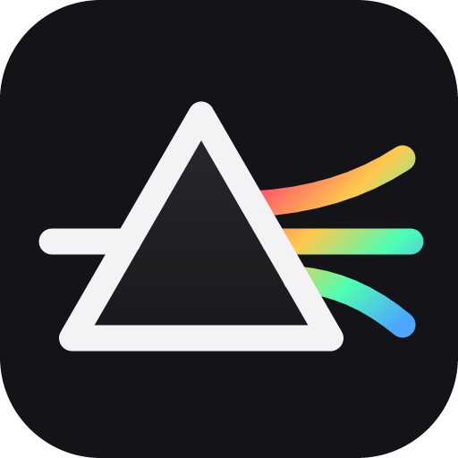
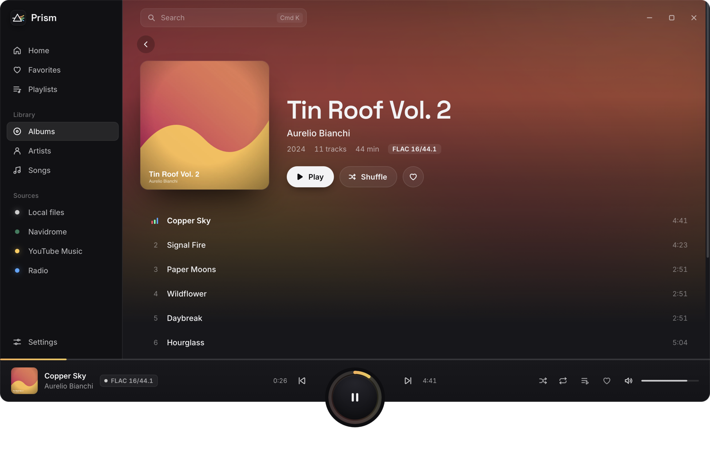
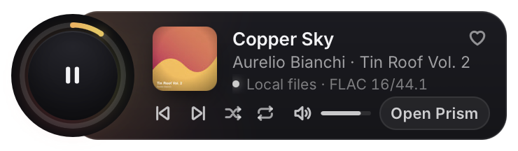

<p align="center">
  
</p>

<h1 align="center">Prism</h1>

<p align="center"><strong>One player, every color of sound.</strong></p>

<p align="center">
  Your own music, your Navidrome server, internet radio and YouTube Music in one player.<br>
  For Windows and macOS.
</p>

<p align="center">
  <a href="https://github.com/wl-lankin/prism/releases/latest/download/Prism-setup.exe"><b>Download for Windows</b></a>
  &nbsp;|&nbsp;
  <a href="https://github.com/wl-lankin/prism/releases/latest/download/Prism.dmg"><b>Download for macOS</b></a>
</p>

<p align="center">
  
</p>
<p align="center">
  
</p>

## Features

- **Local library.** Add folders and Prism keeps the library up to date as files change. Albums, artists, playlists, search, a play queue, repeat and shuffle. Gapless albums and optional crossfade. Covers come from tags, from folders, or are looked up online when missing.
- **Navidrome.** Browse and stream your server next to your local files. Hearts sync with the server's stars both ways, its playlists show up, and plays are scrobbled.
- **Radio.** Search internet radio stations worldwide or see stations near you. Save stations, see the current song, and Prism reconnects after a dropout.
- **YouTube Music.** Sign in in its own window and play it from within Prism. Its queue shows in Prism's queue panel, and media keys control it like any other source.
- **Lyrics.** Synced lyrics follow the song line by line in Now Playing or the side panel, and a click on a line jumps there. They come from .lrc files, the song files, Navidrome, YouTube Music and LRCLIB (online search can be switched off).
- **Flow.** An endless mix from your favorites in your library and on Navidrome.
- **Favorites.** Songs, albums, artists and stations in one place.
- **Mini player, tray and media keys.** A small mini player that can stay on top, a tray icon (Windows) or menu bar item (macOS), and media keys and system media controls that follow whichever source is playing. A global shortcut shows or hides the mini player.
- **English and German.**
- **Updates.** Prism checks in the background and installs on quit or on "Restart to update". It never interrupts what you are listening to.

## Supported formats

Prism decodes the common formats itself and runs a small bundled FFmpeg for the rest.

| Format | File types |
| --- | --- |
| MP3 | `.mp3` |
| AAC | `.aac`, `.m4a`, `.m4b` |
| ALAC | `.m4a`, `.alac` |
| FLAC | `.flac` |
| WAV | `.wav` |
| AIFF | `.aif`, `.aiff`, `.aifc` |
| CAF | `.caf` |
| Ogg Vorbis | `.ogg`, `.oga` |
| Opus | `.opus` |
| WMA | `.wma` |
| APE (Monkey's Audio) | `.ape` |
| WavPack | `.wv` |
| Musepack | `.mpc` |
| TTA | `.tta` |
| DSD | `.dsf`, `.dff` (played as PCM) |
| Matroska / WebM audio | `.mka`, `.webm` |

A file dropped onto the window plays even if it is outside your library.

## Setting up sources

**Navidrome.** Open Settings, enter your server URL, username and password, and connect. The password is kept in the system keychain (Windows Credential Manager or macOS Keychain), not in Prism's files.

**YouTube Music.** Choose YouTube Music in the sidebar and sign in. The sign-in happens in its own window, on Google's page. Prism never sees your password.

**Radio.** Station data comes from [Radio Browser](https://www.radio-browser.info). "Near you" uses a rough location (country and region) looked up with [GeoJS](https://www.geojs.io). You can set a country and region by hand in Settings instead.

## First launch

The 1.0 installers are not code-signed yet, so your system warns you the first time.

- **Windows:** if SmartScreen blocks the installer, click "More info", then "Run anyway".
- **macOS:** right-click Prism in Applications, choose "Open", then confirm. Or run this in Terminal:

  ```
  xattr -dr com.apple.quarantine /Applications/Prism.app
  ```

## Building from source

You need Node.js, Rust and the [Tauri 2 prerequisites](https://tauri.app/start/prerequisites/) for your system.

```
npm ci
npm run tauri dev
```

In development Prism uses the FFmpeg on your `PATH` (or `PRISM_FFMPEG` and `PRISM_FFPROBE`). Release builds bundle their own; see [docs/ffmpeg.md](docs/ffmpeg.md) and [docs/releasing.md](docs/releasing.md).

```
npm test
npm run check
cargo test --manifest-path src-tauri/Cargo.toml
```

## Credits

Made by [Wolfgang Linz](https://wolfgang-linz.de). Prism builds on many open-source projects; the full list with licenses is in the About dialog and in [`src/lib/licenses.json`](src/lib/licenses.json). The bundled FFmpeg is LGPL 2.1 or later, and its source is attached to each release. The Navidrome logo belongs to the [Navidrome](https://github.com/navidrome/navidrome) project (GPL-3.0); Prism is not affiliated with it.

## License

[MIT](LICENSE)
